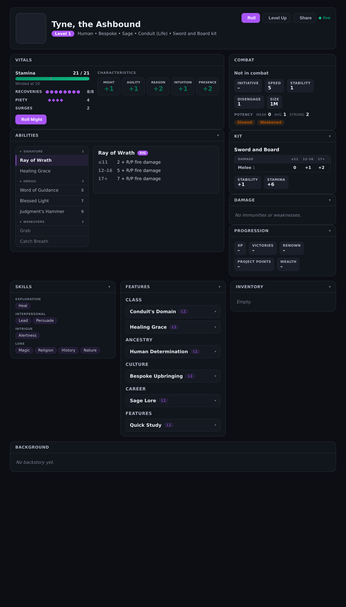

# Draw Steel Character Sheet — Design

> Reference for the hero character-sheet widget (`widgets/character-sheet.js`):
> what it does and why. Field paths are in `docs/FOUNDRY-SYNC-MAP.md`.

## Purpose

A read-only DM reference: a director looks up a player's abilities, stats and
defenses while building monsters or writing notes, so data completeness beats
interactivity. Foundry is the source of truth; nothing on the sheet writes
back, except the origin picker and the Changes drawer in the paper layout.

## Testing

Pure logic (`tierOdds`, `substituteFormula`/`tierFragments`, `groupOf`,
`classifyFeature`, skill grouping, label humanizers) is tested in
`tools/test-character-sheet.mjs`, the arithmetic evaluator in
`tools/test-arith-evaluator.mjs`, escaping in
`tools/test-character-sheet-xss.mjs`. The widget is a browser IIFE that exports
these helpers through `module.exports` off-browser (its `Chronicle.register`
side effects are guarded on a null `Chronicle`). Visuals are checked by
rendering the real widget headlessly against mock data.

## Reference renders

Headless renders against mock data; refresh when the design changes.

| | |
|---|---|
| Full sheet | `docs/images/character-sheet-full.png` |
| Ability card, expanded ("For <hero>" odds) | `docs/images/ability-card-expanded.png` |
| Ability rail, long list (filter + collapsed Maneuvers) | `docs/images/ability-rail-long-list.png` |

---

## Layout

Top to bottom (`buildSchema`): Identity, Vitals and Characteristics (full
width, pinned open), then a main column (Abilities, Features, Skills) beside a
side column (Combat, Kit, Damage, Inventory, Progression). The frame stacks the
columns on a phone, so DOM order is phone order. Chronicle places its own Items
and money panel; the in-sheet Inventory appears only when the host does not
show it. Background (player-private backstory) and GM Lore (director notes) are
permission gates, not data gates: a viewer who may not read them gets no box
rather than an empty placeholder.

---

## Paper layout

When `Chronicle.sheetMotion` exists the widget renders on Chronicle's sheet
contract instead of boxes: a `data-sheet` root, a `.paper-stack > .paper`
holding the parts, and each part with more to show is a `.paper-pull` with a
`data-sheet-open` button whose body is a `<template data-sheet-panel>` (turn,
abilities, kit, damage, progression, items, features, skills, notes; the
abilities panel opens from the All abilities word under the list, not from a part). Items,
Notes and GM lore keep the box sheet's gates. Changing numbers carry `data-v` /
`data-pv`, and the widget calls `Chronicle.sheetMotion.land` after the origin
picker changes one. Panel content is wired from `sheet:panel-ready`, because the
engine clones the template on every open. The origin picker (Ancestry, Culture,
Career, Kit) opens across the full width under the identity row. Layout rules live in the widget's injected `<style>`, scoped to
`[data-sheet][data-sheet-style=...]` and reading `--paper-*` tokens. Without
`sheetMotion` the box render is used unchanged.

On paper the sheet's face is the hero's turn: Hero · Draw Steel, an identity
line (ancestry, class and level, subclass, kit; Culture and career are one fold
away and keep their pickers), the This turn part, then the abilities. On a
phone and in the paper styles the name is printed only in Chronicle's page
header; the computer dashboard (below) prints it as its own heading.

A choice not made yet (ancestry, culture, career, kit) is never printed as an
empty value. It is named on one "Still to choose" line under the identity, each
word opening its picker; the line goes when nothing is left. After a pick the
identity is drawn again (`pIdentityInner`).

The default style, "modern", is the quiet look (`quietLookCss`): no frames,
hairlines between the parts, the class and level as a heading with every
choice made as a labelled value, and the Items to Notes rows beside the
abilities. Both identities are in the markup (`sh-id-l` for the paper styles,
`sh-id-q` for the quiet look) and the style shows one, so a style changed in
the Customizer preview needs no redraw. The other styles keep their own frames.

### The computer dashboard

In the quiet look, a sheet at least 820px wide is laid out as a dashboard
(`dashCss`, a container query on `.sh-sheet`, so the sheet's own width decides
and not the window's). The phone and the paper styles never see it.

- Header: portrait (`dashPortrait`), name, the identity tags with a "Still to
  choose" list of pickers (`dashTodoTags`), and the progression box (level,
  victories, XP, renown, wealth) that opens the Progression panel.
- A row of number boxes (`dashBoxes`): the five characteristics, then Stamina
  (opens the turn panel), speed, stability, disengage, size and save. Under
  it (`dashUnder`): heroic resource, surges with their damage, potency (the
  synced fields, otherwise the glossary rule from the highest characteristic),
  damage immunities and weaknesses, and conditions. Vitals and conditions
  stay read-only.
- At 1100px and wider a left column (`dashRailInner`) holds Skills by group,
  Languages and the Kit's numbers. Narrower, the same list is a Skills tab.
- Tabs: Abilities (below), Skills (narrow only),
  Features, Equipment and Story. Arrow keys, Home
  and End move between them; the open tab survives a redraw. Editor saves
  redraw the panes, the column and the tab counts (`refreshDash`).
- A strip pinned to the top once the number boxes scroll away (`attachDashPin`,
  an IntersectionObserver on the scroll container): portrait, name, Stamina,
  heroic resource, surges and recoveries. It is hidden from screen readers,
  because it repeats what is already on the page.

The Abilities tab (`dashAbilities`) replaces the face's list on the
dashboard; the face list stays for phones and the paper styles.

- One group per action (Main action, Maneuver, Triggered action, Free
  strike), each with its own column headings: name, cost, distance, target,
  and for main actions and free strikes the hero's damage at each tier. A
  maneuver shows the first sentence of what it does under its name, a
  triggered action its trigger. Signature abilities come first, then by cost.
- The moves every hero has (the common abilities, plus the Free Strike main
  action, `isEveryHero`) are one paragraph of names under "Every hero can";
  a name opens that move's card under the paragraph.
- A filter row shows one group or all. When something costs more than the
  current heroic resource, a switch ("Only what 3 Insight pays for") folds
  those rows into one line per group that names each with its cost; "Show
  them" brings back one group, and turning the switch off brings back all of
  them, greyed.
- The open tab, the filter, the switch and the rows the reader unfolded
  survive a redraw, and also Chronicle reloading the page after a save,
  which replaces the sheet's element: `keepDashView` keeps them by campaign
  and page for a moment and the new sheet takes them once
  (`dashViewToKeep`, `applyDashView`). Rows are matched by name.
- A row unfolds in place to the full card (`dashAbCard`): the rules on the
  left, and on the right the roll for this hero, how often each tier comes
  up out of 100, the results with damage added and potency filled in from
  `potencyOf`, and what it costs against what the hero has.

Descriptions come from the pack's files (`kits.json`, `ancestries.json`,
`cultures.json`, `careers.json`, `classes.json`, read through `editRefs`), at
three lengths:

- Short, in place: the Story tab's "Where they come from" (`originRows`) has
  one row per origin with the entry's description (the class keeps its first
  paragraph) and a subclass row named by the class ("Shadow college" for a Shadow).
  Every reader sees it; the backstory and GM lore under it keep their gates.
  The kit's words (`kitWords`: description, the pack's equipment sentence,
  signature ability) sit on the Kit card, the Equipment tab and the phone's
  Kit panel.
- Long, as a panel: "Its traits", "What it gave" and "All of it" open
  `origin-<kind>` panels (`originPanelHtml`): the whole description, then
  what the entry gives (size, speed and traits with their cost; skills,
  languages, perk, project points and questions; a culture's language,
  aspects and skills; the class's numbers).
- None: a name the pack does not have reads "No description yet." and opens
  nothing; a choice not made reads "Not chosen yet." On phones and in the
  paper styles the short rows are in the Story panel, which is the owner's
  and the GM's; they open nothing there, because a panel opened from a panel
  loses its way back.

The quiet look marks the root `data-sheet-wide`, so Chronicle widens the
folio and the tabbed panel under it to 1160px on a screen at least 1480px
wide (the folio is `width: var(--sheet-width, 920px)`). While the dashboard
prints the name, the root carries `data-sheet-names-page` and Chronicle's
header keeps its name for screen readers only. Both follow a style switch
(`syncPageHooks`); the paper styles keep their 920px page.

Parts only the dashboard shows carry `sh-dq`; face parts it replaces carry
`sh-fq`. Both are in the markup for every style, so switching style needs no
redraw.

The face lists abilities under Main action, Maneuver, Triggered and Free strike
(`actionKind`: Foundry's `system.type`, with `category: freeStrike` for free
strikes; a heading with nothing under it is left out, and moves share Maneuver).
Under each heading the hero's own abilities come first. The ones every hero has
(`COMMON_ABILITIES`, the pack's `common` abilities by name) follow in one fold,
"Every hero's main actions" or "Every hero's maneuvers and moves". The fold is
rendered open; the quiet look gives it a heading and shuts it at mount, and a
redraw keeps whichever way the reader left it.
Each is a fold: name, a star for signature, the cost as a tag (the reason when
the hero cannot pay it), the hero's own tier results from the first damage
effect (`heroResult`), and under it the distance and one effect sentence. The
fold shows the three tiers and the effect, and its Full card word swaps that
for the whole rules card in the same line (Short card swaps back). All abilities,
under the list, opens the Abilities panel. A free strike is always listed: the synced one, or a line from
the kit's damage bonus per tier, because the base damage is Foundry's and is not
invented here. Kit, Items, Features, Skills and Notes are quiet ledger lines.

The paper Abilities panel has Signature / Heroic / Other tabs and lists each
ability in the open tab as its own fold, cheapest first; the first starts open,
and a filter box appears at 10 or more abilities. The master-detail pane below
is the box layout only.

## Transformation layers

A layer is a transformation over the hero (Revenant, Vampire Scion) that
Chronicle stores beside the page and the sheet applies when it draws; the
hero's Foundry fields are never written, so taking a layer off restores them.
The sheet reads `GET /campaigns/:id/pages/:eid/layers` (`{layers, canEdit}`;
any refusal means no layers). A changed value shows the old one struck through,
added features carry the layer's tag, and features a layer set aside are listed
struck under "Set aside by a transformation". The ready-made presets are
`data/transformations.json` (Director data); `tools/test-hero-layers.mjs` pins
the engine, the presets' wording and the drawer.

The Changes drawer is the Director's, shown only when the viewer is a Director
and Chronicle answers `canEdit`. A Changes tab under the identity row opens it
inline: the layers on the hero as tick boxes, then the presets not yet on.
Picking a preset redraws the sheet as the preview, with what it moves struck in
the style's warning colour, and the preset's choices sit in the drawer:
Revenant's ancestry points (its quick build ticked), which priced traits of the
old ancestry Previous Life keeps, and numbers the Director corrects by hand
because a lost trait changed them. Overspending holds Push back. Push stores the
layer (`POST`), unticking previews the hero without one and Take it off removes
it (`DELETE`); Discard or closing the drawer drops the preview. The box render
has no drawer.

The Director's own presets live in the Homebrew Workshop: **Save as my preset**
(on a canon preset's preview, once the Workshop has answered) asks for a name
and stores a recipe with one Director-only `transformation` part holding the
layer exactly as previewed, choices settled. The drawer lists them under "Your
own", read from the recipes whose `partKinds` include `transformation`. A
Workshop rule's **Put the transformation on the hero** runs in the browser
(`Chronicle.homebrewActions['put-on-transformation']`): it opens the hero the
rule was set off on with `?transform=<recipe>`, which opens the drawer with that
preset previewed, so a rule never puts a layer on without the Director pressing
Push.

---

## Abilities section

**Shape: bare master–detail, monochrome.** A grouped list (master) plus a detail pane.
The look is minimal and restrained: dark grayscale with a single violet accent (the
Sig badge, the selected-row edge, glossary links). There are no color-coded tier
bands, no action glyphs and no gradient chrome in the resting views.

1. **List** — plain rows: name plus heroic-resource cost, grouped Signature / Heroic /
   Maneuvers, and ordered by cost within a group. An ability is Signature or Heroic
   by its category, Heroic also when it has a cost, and a Maneuver otherwise. The
   selected row gets a subtle accent left edge; maneuvers are dimmed.
2. **Resting pane** — with nothing selected the pane shows a quiet "Select an
   ability" prompt rather than auto-opening one.
3. **Two zoom levels, no expand button.**
   - **Small card (default).** Clicking a row fills the pane with a bare card: a
     header line (name · `Sig` · cost) and three plain tier lines (≤11 / 12–16 / 17+)
     with glossary `{@terms}` in accent. When no tier ladder can be derived (a
     non-damage effect) it shows the power-roll line and a teaser of the effect.
   - **Hover** lifts and glows the card, with a faint "click to expand" hint. The
     whole card is the click target (Enter and Space work too).
   - **Click** swaps in the big card; its close button or Escape returns to the small
     card.
4. **The big card has two sections.**
   - **① The rules** — identical for everyone: keywords, distance, target,
     power-roll characteristics, the tier ladder, trigger and effect text.
   - **② For \<hero>** — computed for this hero, and shown only when the ability has
     power-roll characteristics and the hero's matching characteristic is synced:
     1. **Roll expression** — `2d10 + N (Characteristic)` using the hero's best
        applicable characteristic.
     2. **Average → tier** — `11 + N`, mapped to its tier.
     3. **Tier odds** — T1 / T2 / T3 percentages by enumerating all 100 outcomes of
        2d10, with a natural 19–20 counted as Tier 3.
     4. **Resolved per-tier damage** — the characteristic substituted into each
        tier's damage formula and evaluated.
   - **Not computed:** hit or miss against defenses (Draw Steel has no AC), target
     state, edges and banes (situational), affordability against the current
     resource (live combat state, not sheet data), and the kit's per-tier damage
     bonus (shown on the Kit box, not folded into the ability). These would make the
     card wrong more often than right.
5. **Glossary lookup.** Rule terms such as `{@condition slowed}` render with a dotted
   underline in their category color, and bare condition names in synced prose are
   wrapped the same way. Hovering or focusing a term opens a small dark tip box with
   its definition. Ability keyword badges and skill chips use the same tip box. It
   never reflows the sheet, and it is hover and focus only (there is no tap
   behavior). Definitions come from `data/rules-glossary.json` and
   `data/skills.json` through `widgets/reference-renderer.js`.
6. **Narrow cards.** The small card is at most 420px wide and the big card 520px,
   left-aligned in the pane, rather than stretched across it. A tight card reads
   better and matches the bare look.
7. **Responsive.** On a wide screen the list and pane sit side by side. At 680px and
   narrower the list stacks above the pane and the cards fill the width.
8. **Long lists.** A hero carries their whole kit plus every universal maneuver
   (about 21 rows), so the rail must not sprawl:
   - **Capped scroll** — the rail scrolls inside itself and never shoves the pane down.
   - **Collapsible groups** — each group header is a toggle with a caret and a count
     badge. On a long list (10 or more abilities) the dimmed Maneuvers group starts
     collapsed; Signature and Heroic stay open.
   - **Filter box** — a sticky "Filter abilities…" input appears on long lists;
     typing narrows rows live, hides emptied groups and force-opens collapsed ones so
     a match inside Maneuvers still surfaces.

---

## The other sections

Every field gets a renderer shaped to its content: vary the UI by what the data is.

- **Skills** — trained skills as compact chips grouped by the five Draw Steel skill
  groups (Crafting / Exploration / Interpersonal / Intrigue / Lore), mirroring the
  official sheet, ids humanized (`handleAnimals` → "Handle Animals"). An unknown id
  lands in an "Other" group rather than vanishing; languages follow as their own
  group. The group map is hardcoded in the widget.
- **Kit** — a stat box: the melee and ranged damage-tier mini-ladder
  (≤11 / 12–16 / 17+) plus flat bonus chips (stability / speed / stamina /
  disengage). Kit is reference stats, so it is not a clickable card.
- **Vitals** — Surges as a statline beside the heroic-resource count. A heroic
  resource has no maximum, so it is a bare count with one accent pip.
- **Combat** — Speed, Stability, Disengage, Size and Save chips, movement-mode badges
  (fly, climb, swim, burrow, teleport, hover), a compact Potency strip (weak / avg /
  strong), and condition pills Title-cased from the `statuses` ids. Initiative,
  in-combat and round are not shown: Draw Steel uses alternating activation (no
  initiative roll), and turn order belongs on the Character viewer page.
- **Damage** — damage immunities and weaknesses, plus the conditions the hero is
  immune to.
- **Progression** — XP, victories, renown, wealth.
- **Inventory** — Treasures, then the hero's linked item pages. Treasures are Draw
  Steel's magic-item system (one Foundry `treasure` item type with a category of
  consumable, trinket, leveled or artifact, plus kind, echelon, keywords and
  quantity). They change what a hero can do in a fight, so they carry high reference
  value; they render grouped by category, each an accordion when it has a description.
- **Features** — built as a defensive framework. Foundry stores class, ancestry, kit,
  culture and career features all as generic `feature` items, and a feature does not
  record which item granted it (`system.source` is the publication book). So instead
  of trusting one field, `features_json` projects every feature (name, description,
  level, `_dsid`, source book) and the renderer classifies each by matching its
  `_dsid` or name against the hero's own class, subclass, ancestry, culture, career
  and kit names, bucketing into those groups. Anything it can't place lands in a
  generic "Features" group; if nothing classifies, it renders one flat list rather
  than fake headers. Perks and Titles follow as their own groups. Each feature is a
  native `
` accordion (name and level, description on expand), so a long list
  collapses with no JS. The classifier is a heuristic: at worst it leaves features
  ungrouped.
- **Background** — a teaser line and a "Read full story" button that opens a typeset
  reading view, so large lore doesn't accordion-shove the sheet.

## Glossary and skills source

The glossary and skills come from steelcompendium.io (GitHub org
`SteelCompendium/data-md`), the Draw Steel 1.0 ruleset as machine-extractable
Markdown and YAML, under MCDM's Draw Steel Creator License (`LICENSE`,
`data/NOTICE.md`). Rules text may be quoted in `data/*.json` provided the
licence's notice is included and MCDM endorsement is not implied. The
maintainer has read the licence and confirmed this (`LICENSE`, closing section).

`data/skills.json` and the `keyword` entries of `data/rules-glossary.json` come
from there; keywords are not discrete files at the source, so they were curated
by hand. Skill chips and keyword badges show definition tips;
`reference-renderer.scanText()` and `refSynced()` wrap bare condition names in
synced prose. Only conditions are auto-scanned, not movement terms.

## Do not want

Explicitly rejected; don't re-propose:

- **Hover-to-open** for the main ability card — there are too many abilities. The big
  card opens on click; hover is reserved for the small glossary tips.
- **Inline accordion dropdowns** for ability detail — replaced by the detail pane and
  expand card. Actions shouldn't be dropdowns.
- **The full statblock as the default detail** — too heavy. The big card is opt-in via
  the expand click; the default detail stays compact.
- **A big always-expanded ability wall** (every ability fully rendered at once).
- **Actions rendered as dropdown menus.**
